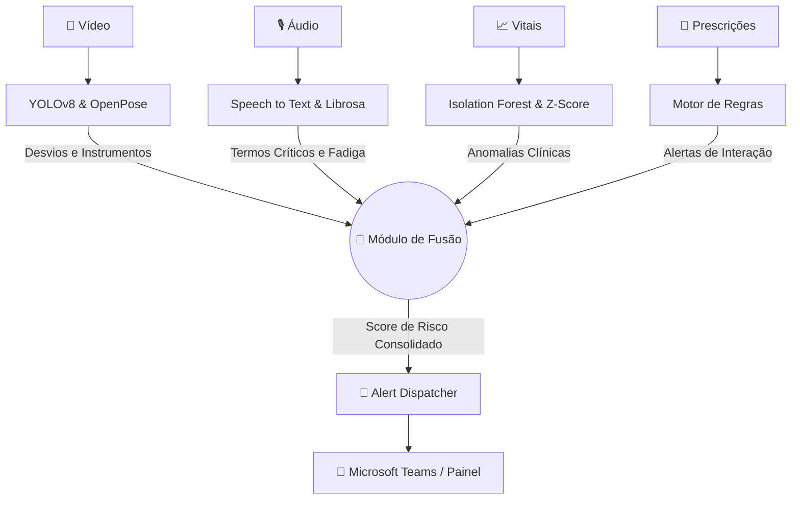

# 🏥 Sistema Multimodal de Triagem e Alerta Médico


**Tech Challenge Fase 4**

Este projeto é um sistema de monitoramento inteligente desenvolvido para ambientes clínicos e cirúrgicos. Ele utiliza a **fusão de dados multimodais (Vídeo, Áudio, Sinais Vitais e Prescrições)** para detectar anomalias, calcular um Score de Risco unificado e despachar alertas preventivos em tempo real para equipes médicas, visando mitigar falhas operacionais e aumentar a segurança do paciente.

---

## 📑 Índice
- [🚀 Funcionalidades Principais](#-funcionalidades-principais)
- [🧠 Arquitetura Multimodal](#-arquitetura-multimodal)
- [📁 Estrutura do Projeto](#-estrutura-do-projeto)
- [💻 Como Executar](#-como-executar)
- [⚠️ Dados, Licença e Limitações](#️-dados-licença-e-limitações)
- [📄 Relatório Técnico](#-relatório-técnico)

---

## 🚀 Funcionalidades Principais 

O sistema atende integralmente aos requisitos da Fase 4 através de três pilares de análise:

### 1. Análise de Vídeo
*   **Fisioterapia e Postura:** Utiliza **OpenPose / YOLOv8-pose** para detectar desvios posturais e movimentos fora do padrão durante exercícios.
*   **Cirurgia (Laparoscopia):** Utiliza **YOLOv8** treinado via *fine-tuning* (dataset CholecT50) para detectar instrumentos cirúrgicos, medindo a ausência na cena, movimentos bruscos ou presença em zonas de risco.

### 2. Análise de Áudio (Consultas Médicas)
*   **Transcrição:** Processamento da fala do paciente para texto (preparado para **Azure Speech to Text**).
*   **NLP e Sentimento:** Extração de termos críticos de risco (ex: "dor no peito", "falta de ar") usando lógica de NLP (preparado para **Azure Text Analytics**).
*   **Fadiga Vocal:** Extração de *features* acústicas via Librosa (Jitter, RMS, taxa de fala, pausas) para identificar sinais físicos de fraqueza ou disartria.

### 3. Detecção de Anomalias (Séries Temporais)
*   **Sinais Vitais:** Identifica deterioração clínica monitorando Frequência Cardíaca, Pressão Arterial e SpO2 através de limites críticos, Z-Score móvel e modelos de ML não supervisionados (**Isolation Forest**).
*   **Evolução de Prescrições:** Motor de regras que dispara alertas para mudanças abruptas de dosagem ou interações medicamentosas perigosas.

---

## 🧠 Arquitetura Multimodal

O fluxo de dados do projeto ocorre da seguinte maneira:



---

## 📁 Estrutura do Projeto

| Caminho | Descrição do Componente |
|---|---|
| 📓 `notebooks/main.ipynb` | Fluxo otimizado para o Google Colab: treinamento do YOLOv8 no CholecT50 e inferência. |
| ⚙️ `src/pipeline.py` | Orquestrador principal. Roda todo o pipeline multimodal via linha de comando. |
| 🧠 `src/anomaly/` | Detecção de anomalias temporais: `vitals.py` (Isolation Forest) e `prescriptions.py`. |
| 🎙️ `src/audio/` | Processamento de som: Transcritor, Text Analyzer (termos críticos) e Voice Features (Librosa). |
| 🎥 `src/video/` | Visão computacional: `pose_analyzer.py` (OpenPose) e `surgical_tools.py` (YOLOv8). |
| 🚨 `src/alerts/` | Roteamento de alertas (JSONL, Azure Event Grid e webhook Teams). |
| 🧪 `tests/` | Suíte de testes automatizados (`pytest`) validando os algoritmos de anomalia. |

---

## 💻 Como Executar

### 1. Ambiente Local (Pipeline Completo Multimodal)

**Pré-requisitos:** Python 3.9+ e dependências instaladas.

```bash
# Crie e ative o ambiente virtual
python -m venv .venv && source .venv/bin/activate

# Instale as dependências
pip install -r requirements.txt

# Execute a suíte de testes (valida a lógica de anomalias de vitais e áudio)
pytest

# Rode o orquestrador multimodal completo simulando um paciente (Ex: P001)
# Este comando aciona a fusão de Vídeo (pose), Áudio, Vitais e Prescrições.
python -m src.pipeline --patient P001 \
    --video data/raw/fisio.mp4 \
    --audio data/samples/audio/consulta_P001_alerta.wav \
    --vitals data/samples/vitals_P001.csv \
    --prescriptions data/samples/prescriptions_P001.csv
```

### 2. Google Colab (Foco no Treinamento de Vídeo Cirúrgico)
Para treinar e testar a parte pesada de processamento de imagem (YOLOv8 no dataset CholecT50):
1. Abra o arquivo `notebooks/main.ipynb` no Colab.
2. Altere o ambiente de execução para **GPU (T4)**.
3. Insira o link deste repositório na variável `REPO_URL` e execute as células.

---

## ⚠️ Dados, Licença e Limitações

*   **Dados Sintéticos para MVP:** A fim de respeitar a **LGPD** e garantir a privacidade *by design*, este projeto utilizou consultas médicas sintéticas geradas via conversor Text-to-Speech (TTS) e geração matemática simulada de sinais vitais. Nenhuma gravação de paciente real está incluída no repositório.
*   **Vídeo Laparoscópico:** Utiliza o dataset **CholecT50**, sob licença **CC BY-NC-SA 4.0** (uso não comercial). *Citação: C.I. Nwoye et al., Medical Image Analysis, 78 (2022).*
*   **Integração Azure:** A arquitetura do código (`src/audio/transcriber.py`) e dos alertas contempla as integrações oficiais com Azure Cognitive Services e Event Grid. No entanto, sua execução plena depende da injeção de chaves de API válidas no arquivo `.env`. Um *fallback* via API HTTP genérica foi configurado para demonstração funcional.

---

## 📄 Relatório Técnico
Para obter informações aprofundadas sobre a arquitetura, métricas, e detalhes da fusão *Late Fusion*, consulte o **Relatório Técnico Oficial**:
👉 **[Leia o Relatório Técnico Completo Aqui](docs/relatorio_tecnico.md)**

<br>
<p align="center">
  <i>Desenvolvido para o Tech Challenge Fase 4 · FIAP</i>
</p>
