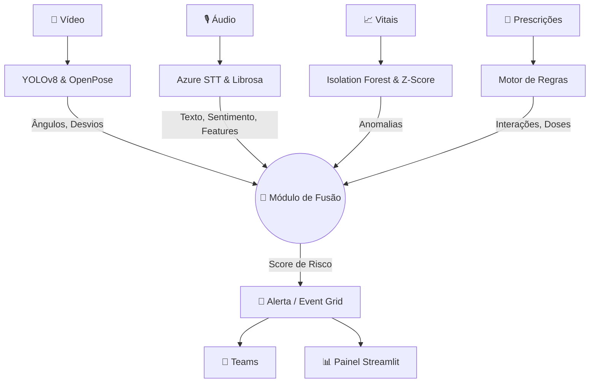

# 📄 Relatório Técnico — Tech Challenge Fase 4

---

## 🎯 1. Introdução e Objetivo

O presente relatório detalha o desenvolvimento e a arquitetura da solução proposta para o **Tech Challenge Fase 4**. O projeto consiste em um sistema de **monitoramento inteligente e triagem automatizada** voltado para ambientes clínicos e cirúrgicos.

O objetivo principal é mitigar falhas operacionais e aumentar a segurança do paciente através da fusão de múltiplas fontes de dados (áudio, vídeo, sinais vitais e histórico de prescrições). Para isso, o sistema emprega modelos avançados de Inteligência Artificial para analisar o ambiente em tempo real, identificar padrões anômalos (como movimentos bruscos em cirurgias, sinais vitais em declínio ou termos críticos ditos por pacientes) e agregar essas informações em um **Score de Risco** unificado, emitindo alertas preventivos para a equipe médica.

---

## 🔄 2. Fluxo Multimodal (Arquitetura)

O sistema integra múltiplas fontes de dados (Vídeo, Áudio, Vitais e Prescrições) para gerar um score de risco e emitir alertas em tempo real.

---

## 📊 3. Modelos Aplicados por Tipo de Dado

| Tipo de Dado | Modelo / Serviço Utilizado | Saída Principal |
| :--- | :--- | :--- |
| **🎥 Vídeo (Fisioterapia)** | YOLOv8-pose / OpenPose | Ângulos, desvios posturais |
| **🎥 Vídeo (Cirúrgico)** | YOLOv8 (Fine-tuning) | Detecção de instrumentos, tempo de ausência, movimentos bruscos |
| **🎙️ Áudio** | Azure Speech to Text; Azure Language; Librosa | Transcrição, sentimento, termos críticos, features vocais |
| **📈 Vitais** | Limites clínicos, Z-score móvel, Isolation Forest | Anomalias por sinal e multivariadas |
| **💊 Prescrições** | Regras determinísticas (dose, suspensão, interação) | Alertas de alterações inesperadas ou de risco |
| **🚶 Movimentação** | Z-score móvel, detector de imobilidade | Picos bruscos de movimento, imobilidade prolongada |
| **🧠 Fusão** | *Late fusion* ponderada + Bônus de concordância | Score final e classificação de severidade |

---

## 📂 4. Datasets e Pré-processamento

*   **Áudio:** Foram utilizadas 3 consultas **simuladas** geradas por síntese de voz (TTS do macOS, voz Luciana pt-BR), convertidas para formato WAV (16 kHz, mono), salvas em `data/samples/audio/`:
    *   🟢 `normal`: Sem queixas.
    *   🔴 `alerta`: Sintomas críticos (dor no peito, falta de ar, tontura, desmaio).
    *   🟡 `lenta`: Fala pausada, simulando fraqueza e cansaço.
    > ⚠️ **Nota:** Estes áudios são sintéticos e não correspondem a gravações de pacientes reais.

*   **Vídeo Cirúrgico (CholecT50):** Utilizou-se o pacote *CholecT50 Challenge Validation* (5 clipes) para realizar fine-tuning do modelo YOLOv8 focado na detecção de instrumentos laparoscópicos. Os clipes foram convertidos automaticamente para o formato YOLO, com limpeza de dados removendo frames pretos ou ambíguos.
*   **Vitais e Prescrições:** Para compor o fluxo multimodal de alertas (ex: paciente fictício `CHOLECT-VID75`), foram gerados dados sintéticos de sinais vitais e histórico de prescrições a fim de simular o comportamento da camada de fusão.

---

## 🔬 5. Resultados e Análises

### 5.1 Vídeo
Para o fluxo de **Vídeo Cirúrgico**, o pipeline (`src/video/surgical_tools.py`) processa os frames detectando os instrumentos e extraindo os seguintes indicadores (heurísticas de triagem operacionais):
*   **Instrumento fora do campo:** Percentual de detecções ocorridas fora da zona central segura da imagem.
*   **Movimento brusco:** Deslocamentos abruptos de instrumentos entre frames adjacentes.
*   **Ausência prolongada:** Longos períodos consecutivos sem a presença de instrumentos no quadro, sinalizando possível ociosidade enquanto a câmera opera dentro do corpo.

> *Nota: O projeto também suporta análise de **Fisioterapia** (desvios posturais via OpenPose/YOLOv8-pose) como parte do pipeline global.*

### 5.2 Sinais Vitais e Prescrições

A análise de sinais vitais foi validada contra uma base de dados sintética (gerada para o paciente `CHOLECT-VID75`), projetada para simular cenários de deterioração clínica. 

**Detecção de Sinais Vitais (`src/anomaly/vitals.py`):**
O sistema emprega três abordagens em paralelo para identificar anomalias:
1. **Limites Clínicos e Críticos:** Filtro determinístico (ex: $SpO2 < 92\%$ gera alerta, $SpO2 < 88\%$ gera pontuação máxima de severidade). A validação confirmou a correta identificação de eventos de dessaturação simulados.
2. **Z-Score Móvel:** Analisa janelas temporais curtas para detectar mudanças abruptas em relação à linha de base recente do próprio paciente, independente de ultrapassar limites fixos.
3. **Padrão Multivariado (Isolation Forest):** Algoritmo de *Machine Learning* não supervisionado que analisa a combinação dos sinais (Frequência Cardíaca, Pressão Sistólica/Diastólica e SpO2) para identificar assinaturas anômalas conjuntas, mesmo quando os sinais individuais estão dentro de limites aparentemente aceitáveis.

**Análise de Prescrições (`src/anomaly/prescriptions.py`):**
O motor de regras avaliou o histórico de medicação e identificou com sucesso as seguintes anomalias injetadas na base de dados sintética:
*   **Mudança de Dose:** Disparado quando há flutuação estatisticamente incomum na dosagem diária.
*   **Suspensão Abrupta:** Alertas acionados pela interrupção repentina de medicamentos contínuos.
*   **Interação Medicamentosa:** Identificação de pareamento perigoso de medicamentos prescritos simultaneamente.

### 5.3 Áudio (3 Consultas Simuladas via TTS)

> ⚠️ **Atenção à Transcrição:** A transcrição foi realizada via API Knowlez STT (`src/audio/http_transcriber.py`). O módulo do Azure Speech (`src/audio/transcriber.py`) existe no código, mas **não foi executado por falta de chave de API ativa**. (Saídas salvas em `data/samples/audio/transcricoes_knowlez.json`).
> *Sentimento (Azure Language): [PREENCHER — não executado, sem chave]*

**Análise de Transcrição e Termos Críticos:**

| Áudio | Transcrição Obtida | Termos Críticos Detectados | Alertas de Voz |
| :--- | :--- | :--- | :--- |
| **Normal** | "Bom dia doutor. Estou me sentindo bem, dormi bem esta noite..." *(idêntica ao roteiro)* | Nenhum | Nenhum |
| **Alerta** | "Doutor, desde ontem estou com dor no peito e falta de ar. Tive tontura e quase desmaiei..." *(idêntica)* | dor no peito (0,9), falta de ar (0,8), desmaiei (0,8), tontura (0,5), cansado (0,4) | Nenhum |
| **Lenta** | "Eu, estou com muita fraqueza, e cansaço, não **o** consigo, falar direito..." *(1 erro de transcrição)* | fraqueza (0,5), cansaço (0,4) | Nenhum |

**Análise Acústica (Features Vocais - Librosa):**

| Áudio | Duração | Pausas | Taxa de Fala | RMS | Jitter F0 |
| :--- | :--- | :--- | :--- | :--- | :--- |
| **Normal** | 8,4 s | 6% | 149 wpm | 0,167 | 0,031 |
| **Alerta** | 9,3 s | 6% | 148 wpm | 0,163 | 0,029 |
| **Lenta** | 8,4 s | 11% | 114 wpm | 0,155 | 0,024 |

**Avaliação dos Resultados de Áudio:**
*   ✅ **O que funcionou:** A detecção de termos críticos foi precisa e não gerou falsos alarmes no áudio de controle (normal).
*   ❌ **O que não pôde ser validado:** Por utilizar voz sintética (TTS), nenhum áudio atingiu os limiares físicos de fadiga ou disartria (pausas > 50%, < 80 wpm, RMS < 0,01, jitter > 0,05). Portanto, o *gatilho* de alerta por fadiga não disparou, validando-se apenas a etapa de extração das *features*.

---

## 🔔 6. Fluxo de Alerta (Integração)

O roteamento e o despacho dos alertas são gerenciados pelo módulo `AlertDispatcher` (`src/alerts/dispatcher.py`), que atua sobre o resultado final consolidado pelo Módulo de Fusão. 

O fluxo opera da seguinte maneira:
1. **Filtro de Severidade:** O *dispatcher* avalia o `Score de Risco` final. Apenas eventos que superam o limiar mínimo de severidade (`min_severity`) configurado no sistema acionam o fluxo externo, evitando a fadiga de alarmes da equipe médica.
2. **Log Local de Auditoria:** Todo evento crítico é serializado estruturalmente e salvo em um arquivo JSONL (`data/alerts/`), garantindo rastreabilidade e histórico para auditorias futuras.
3. **Publicação via Event Grid (Nuvem):** Utilizando a SDK do Azure, o sistema publica um evento assíncrono (`EventGridEvent`) do tipo `Hospital.PatientRisk`. Isso permite que o sistema escale, possibilitando que outros microsserviços do hospital assinem esses eventos.
4. **Notificação Push (Microsoft Teams):** Para ação imediata, um webhook formata as 5 descobertas mais críticas (`findings`) e dispara uma mensagem direta para o canal da equipe de resposta rápida, destacando a severidade e o ID do paciente.

*(Nota: Na arquitetura final, a leitura em tempo real desses dados seria apresentada em um painel consolidado como o Streamlit para acompanhamento de longo prazo).*

---

## ⚖️ 7. Limitações, Ética e LGPD

O desenvolvimento de um sistema de triagem automatizada com Visão Computacional e Processamento de Linguagem Natural (NLP) exige extrema atenção às diretrizes éticas e de privacidade (LGPD).

*   **Human-in-the-Loop:** Os algoritmos deste projeto agem exclusivamente como **ferramentas de triagem**. Os alertas gerados pelo YOLOv8 ou pela Análise de Áudio não constituem diagnósticos clínicos ou julgamentos legais de erro médico. A validação final da conduta e do alarme deve ser **sempre realizada por um profissional de saúde qualificado**.
*   **Dados Sintéticos e Anonimização:** Como mecanismo de proteção de privacidade (by design), este MVP utilizou vídeos públicos anonimizados (CholecT50), consultas sintéticas via conversor Text-to-Speech (TTS) e geração matemática de vitais e prescrições. O diretório `data/raw/` não é versionado no Git para mitigar o risco de vazamento de informações de saúde caso o sistema seja alimentado com dados reais.
*   **Viés Algorítmico e Generalização:** Os testes em áudio demonstraram a fragilidade do modelo ao lidar com vozes sintéticas (não atingindo limiares naturais de fadiga/disartria). Da mesma forma, as heurísticas visuais em ambiente laparoscópico foram treinadas em ângulos e condições de iluminação controladas. A aplicação em um hospital real requer treinamento contínuo com dados mais representativos para evitar a degradação da acurácia.

---

## 🚀 8. Próximos Passos (Evolução para v2.0)

O MVP construído durante este Tech Challenge comprovou a viabilidade da arquitetura de fusão multimodal. Para elevar o sistema a um patamar de homologação clínica ou produção, o *roadmap* futuro deve contemplar:

1. **Ativação Plena das APIs em Nuvem:**
   *   Integrar chaves definitivas do Azure Speech-to-Text e Azure Language para substituir o *fallback* atual (Knowlez STT) e habilitar a extração real de Sentimentos e Intenções.
2. **Coleta e Testes com Dados Reais (Áudio):**
   *   Substituir a base de áudios sintéticos (TTS) por gravações reais (devidamente anonimizadas e consentidas) de pacientes apresentando quadros autênticos de disartria e fadiga. Isso permitirá calibrar com precisão os limiares de `pausas`, `wpm` (words per minute), `Jitter` e `RMS`.
3. **Melhorias no Modelo de Visão (CholecT50):**
   *   Aumentar a robustez do YOLOv8 aplicando técnicas de *Data Augmentation* focadas em oclusão (quando a ferramenta é parcialmente coberta por tecido ou sangue) e variações drásticas de iluminação intra-abdominal.
   *   Expandir o treinamento para a versão completa do dataset CholecT50, mitigando o viés do pacote de validação (que possui frames esparsos e não-contínuos).
4. **Interface de Retorno (Dashboard):**
   *   Concluir a integração do barramento do Event Grid com um painel visual (*frontend*) construído em Streamlit ou React, permitindo que a equipe de triagem visualize os gráficos de Z-Score e as *bounding boxes* do vídeo em tempo real, além da notificação já funcional do Microsoft Teams.

  

---

## 🎬 [Anexo] Roteiro do Vídeo de Apresentação (Até 15 min)

Utilize este roteiro como guia para a gravação da apresentação do projeto:

- [ ] **1. Problema e Arquitetura (1 min):** Apresentar o desafio de negócio e mostrar o diagrama do fluxo multimodal.
- [ ] **2. Demonstração de Vídeo (3 min):** Mostrar o upload do vídeo, o processamento de pose, a detecção de desvios e o relatório HTML gerado.
- [ ] **3. Demonstração de Áudio (3 min):** Explicar a transcrição, a extração de termos críticos, análise de sentimento e features vocais. Mencionar o uso da voz simulada.
- [ ] **4. Demonstração de Anomalias (3 min):** Exibir o processamento de sinais vitais (ex: simular queda de SpO2) e regras de prescrição médica alterada.
- [ ] **5. Ação e Alerta (3 min):** Mostrar a *Late Fusion* das anomalias gerando um alerta real recebido no Microsoft Teams ou exibido no painel Streamlit.
- [ ] **6. Conclusões (2 min):** Resumir os resultados alcançados e destacar as limitações técnicas e éticas.
