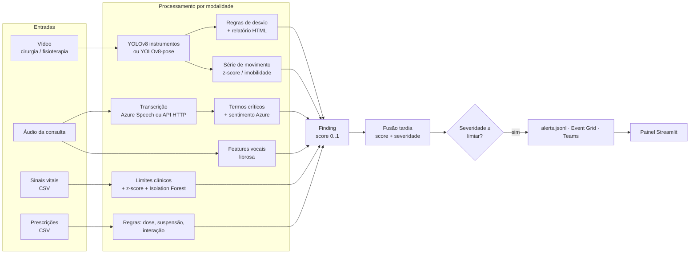
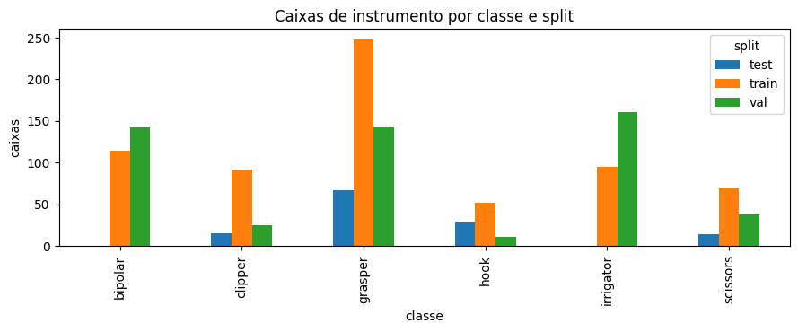
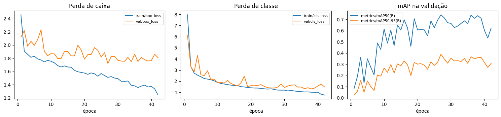
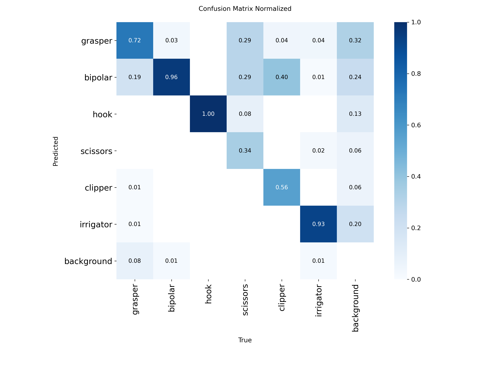
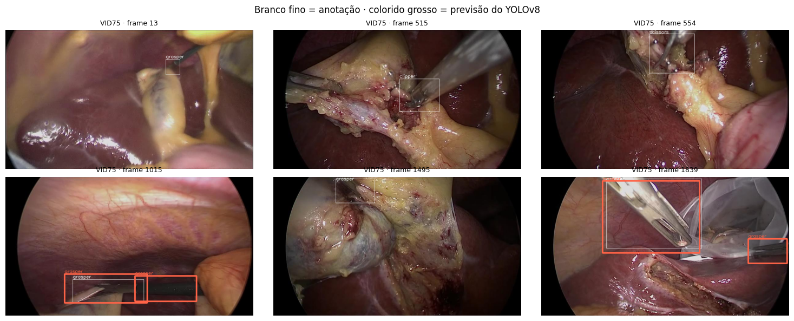
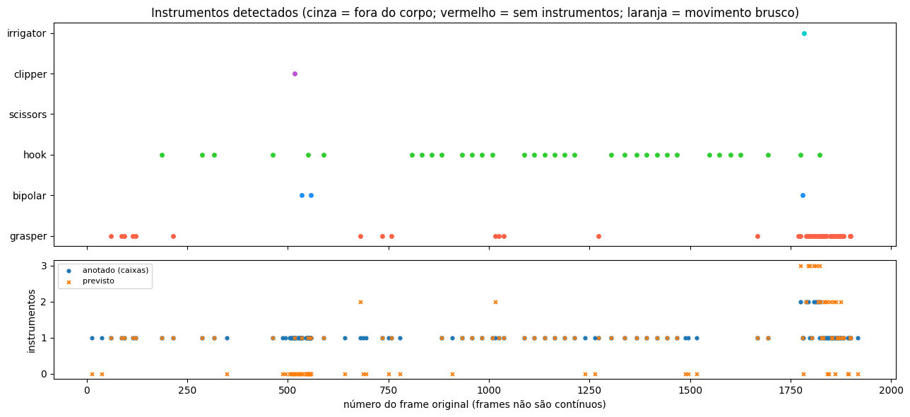

# Relatório técnico — Tech Challenge Fase 4

Monitoramento multimodal de pacientes · FIAP IA para Devs

## 1. Introdução e objetivo

O sistema reúne dados de várias fontes sobre um mesmo paciente: vídeo (cirurgia laparoscópica ou fisioterapia),
áudio de consulta, sinais vitais, prescrições e movimentação. Ele detecta padrões fora do esperado em cada fonte
e combina os achados em um **score de risco**. Quando a severidade passa de um limiar, gera um alerta para a equipe
médica e um relatório automático com os desvios encontrados.

O objetivo é **triagem para revisão humana**. O sistema não faz diagnóstico nem julga a conduta clínica.

## 2. Fluxo multimodal



**Etapas:**

1. **Entrada.** `src/pipeline.py` recebe o ID do paciente e os caminhos de cada fonte. Todas são opcionais; o
   fluxo usa só as que foram passadas.
2. **Processamento por modalidade.** Cada módulo devolve uma lista de `Finding` (`src/schemas.py`), com
   modalidade, tipo do achado, score normalizado de 0 a 1, descrição e detalhes. Esse contrato único permite
   somar fontes diferentes sem acoplar os módulos.
3. **Relatório de vídeo.** A análise de vídeo gera um HTML em `data/reports/video_report_<paciente>.html` com o
   resumo da sessão e a tabela de desvios (`src/video/report.py`).
4. **Fusão.** `src/fusion/risk_score.py` combina os achados de todas as modalidades em um score e uma severidade
   (baixa, média, alta, crítica).
5. **Alerta.** `src/alerts/dispatcher.py` dispara quando a severidade é igual ou maior que `ALERT_MIN_SEVERITY`
   (padrão: média). O alerta é gravado em `data/alerts/alerts.jsonl` e, se as variáveis estiverem configuradas,
   enviado ao Azure Event Grid e a um webhook do Teams.
6. **Painel.** `dashboard/app.py` (Streamlit) lê o JSONL e mostra os alertas filtrados por severidade.

## 3. Modelos aplicados por tipo de dado

| Dado | Modelo / técnica | Arquivo | Saída (tipos de `Finding`) |
|---|---|---|---|
| Vídeo cirúrgico | **YOLOv8n** com ajuste fino no **CholecT50** (detecção de instrumentos) + regras sobre as detecções | `src/video/surgical_tools.py` | `instrumento_fora_do_campo`, `movimento_brusco_instrumento`, `ausencia_prolongada_de_instrumentos` |
| Vídeo de fisioterapia | **YOLOv8-pose** (17 keypoints COCO, mesmo formato do OpenPose) → ângulos articulares; **YOLOv8** COCO para objetos fora da área | `src/video/pose_analyzer.py`, `src/video/object_detector.py` | desvios de amplitude articular, objeto fora da zona permitida |
| Áudio: fala | **Azure Speech to Text** ou API HTTP de transcrição (Knowlez); dicionário clínico de termos críticos; **Azure AI Language** (sentimento e frases-chave) | `src/audio/transcriber.py`, `http_transcriber.py`, `text_analytics.py` | `termo_critico`, `sentimento_negativo` |
| Áudio: voz | **librosa**: proporção de pausas, taxa de fala, energia (RMS), jitter da F0 | `src/audio/voice_features.py` | indícios de fadiga ou disartria |
| Sinais vitais | Limites clínicos por sinal; **z-score móvel** (janela de 12 leituras); **Isolation Forest** multivariado (FC, PAS, PAD, SpO₂) | `src/anomaly/vitals.py` | `fora_do_limite_clinico`, `mudanca_brusca`, `padrao_multivariado_anomalo` |
| Prescrições | Regras: variação de dose ≥ 50%, suspensão abrupta, pares de interação | `src/anomaly/prescriptions.py` | `mudanca_de_dose`, `suspensao_abrupta`, `interacao_medicamentosa` |
| Movimentação | Z-score sobre média móvel (picos) e sequência de imobilidade | `src/anomaly/movement.py` | `movimento_brusco`, `imobilidade_prolongada` |
| Fusão | Fusão tardia ponderada com bônus de concordância | `src/fusion/risk_score.py` | score de risco e severidade |

**Detalhes das regras de vídeo cirúrgico.** O CholecT50 não tem rótulos de erro cirúrgico, então os desvios são
heurísticas sobre as detecções:

- *Fora do campo:* alerta quando 15% ou mais das detecções caem fora da zona central (8%–92% na horizontal,
  5%–95% na vertical).
- *Movimento brusco:* deslocamento do mesmo instrumento entre frames adjacentes ≥ 0,25 (coordenada normalizada)
  e ≥ 3,5 desvios robustos (MAD) acima da mediana. Lacunas na amostragem não contam.
- *Ausência prolongada:* 15 s ou mais seguidos sem instrumento, com a câmera dentro do corpo. Frames pretos
  (fora do corpo) não contam.

**Fórmula da fusão.** Para cada modalidade usa-se o maior score entre os achados dela:

```
score = min(1, 0,6 · pico + 0,4 · Σ(peso_m · score_m) + 0,10 · (nº de modalidades − 1))
pesos: vitais 0,30 · vídeo 0,25 · áudio 0,25 · prescrição 0,10 · movimento 0,10
severidade: crítica ≥ 0,80 · alta ≥ 0,60 · média ≥ 0,35 · baixa < 0,35
```

O bônus de concordância aumenta o risco quando fontes independentes apontam problema ao mesmo tempo.

## 4. Datasets e pré-processamento

| Modalidade | Dados usados | Pré-processamento |
|---|---|---|
| Vídeo cirúrgico | **CholecT50 Challenge Validation** (5 clipes de colecistectomia, ~1,1 mil frames com caixas de instrumentos), licença CC BY-NC-SA 4.0 | `scripts/prepare_cholect50_yolo.py`: descobre o layout, converte rótulos para YOLO, descarta frames pretos e ambíguos, divide **por clipe** (3 treino, 1 validação, 1 teste) |
| Áudio | 3 consultas **simuladas** por TTS (voz Luciana pt-BR, macOS), WAV 16 kHz mono, em `data/samples/audio/`: `normal`, `alerta` e `lenta` | Nenhum além da conversão de formato. **Não são gravações de pacientes reais.** |
| Sinais vitais | `data/samples/vitals_P001.csv`: 288 leituras a cada 5 min (24 h), **sintéticas** (`scripts/generate_synthetic_data.py`, seed 7) | Anomalias injetadas: pico de PAS +55 mmHg (leituras 120–122) e dessaturação progressiva de 95% → 87% com taquicardia (leituras 200–215) |
| Prescrições | `data/samples/prescriptions_P001.csv`, **sintéticas** | Anomalias injetadas: varfarina 5 → 10 mg, AAS junto com varfarina, suspensão da losartana |

Dados reais como PhysioNet (MIMIC) e AudioSet foram considerados, mas não usados. Os detectores leem o mesmo
formato de CSV, então trocar a fonte não exige mudar código.

Cita-se o CholecT50 conforme a licença: C.I. Nwoye et al., *Rendezvous: Attention Mechanisms for the Recognition
of Surgical Action Triplets in Endoscopic Videos*, Medical Image Analysis, 78 (2022) 102433.

## 5. Resultados

As métricas de detecção do YOLOv8 (5.1) vêm do treino no Colab. Os números das seções 5.2 a 5.5 foram medidos
rodando o código do repositório sobre as amostras em `data/samples/`.

### 5.1 Vídeo cirúrgico (YOLOv8 + CholecT50)

Fonte: notebook `notebooks/main.ipynb` executado no Google Colab (GPU Tesla T4, Ultralytics 8.4.210).

**Dados após a conversão.** Divisão por clipe, sem frames de um mesmo clipe em dois conjuntos:

| Conjunto | Clipes | Imagens | Caixas por classe |
|---|---|---|---|
| Treino | VID68, VID70, VID73 | 567 | grasper 248 · bipolar 114 · irrigator 95 · clipper 92 · scissors 69 · hook 52 |
| Validação | VID74 | 441 | irrigator 161 · grasper 144 · bipolar 143 · scissors 38 · clipper 25 · hook 11 |
| Teste | VID75 | 120 | grasper 67 · hook 30 · clipper 16 · scissors 14 |



O clipe de teste não tem *bipolar* nem *irrigator*, por isso só quatro classes entram nas métricas de teste.
Todas as imagens convertidas têm ao menos um instrumento; nenhum frame foi descartado como ambíguo.

**Treino.** YOLOv8n pré-treinado em COCO, imagens de 640 px, lote de 16, até 50 épocas com parada antecipada
(paciência de 15). Aumento de dados: flips horizontal e vertical, rotação de até 15°, mosaico, RandAugment e
apagamento aleatório. O treino parou na época 42; os melhores pesos são da **época 27**. Duração: cerca de 10 min.



A perda de treino continua caindo até o fim, enquanto a perda de caixa na validação fica estável em torno de 1,8
a partir da época 10 e o mAP de validação oscila bastante. É o sinal esperado de **sobreajuste** com tão poucos
clipes.

**Métricas na validação (VID74) e no teste (VID75, nunca visto no treino):**

| Métrica | Validação (VID74) | **Teste (VID75)** |
|---|---|---|
| mAP50 | 0,740 | **0,518** |
| mAP50-95 | 0,389 | **0,259** |
| Precisão | 0,624 | **0,846** |
| Recall | 0,664 | **0,384** |

| Classe (teste) | Instâncias | Precisão | Recall | AP50 | AP50-95 |
|---|---|---|---|---|---|
| hook | 30 | 0,79 | 0,76 | **0,840** | 0,435 |
| grasper | 67 | 0,59 | 0,67 | **0,633** | 0,269 |
| clipper | 16 | 1,00 | 0,10 | **0,502** | 0,304 |
| scissors | 14 | 1,00 | 0,00 | **0,096** | 0,027 |



**Leitura dos resultados:**

- **Os dois instrumentos principais funcionam razoavelmente.** *Hook* e *grasper* têm recall de 0,76 e 0,67 no
  teste. Na validação, *hook* (100%), *bipolar* (96%) e *irrigator* (93%) são quase sempre reconhecidos.
- **O recall geral baixo (0,38) vem de *scissors* e *clipper*.** O modelo detectou 1 de 16 *clippers* e nenhuma
  das 14 *scissors* do teste. A precisão de 1,00 dessas classes não significa acerto: o modelo quase não as
  previu. A matriz de confusão mostra o motivo: na validação, 40% dos *clippers* viraram *bipolar*, e a
  *scissors* se espalha entre *grasper*, *bipolar* e *hook* (só 34% de acerto). São instrumentos finos e
  parecidos, com poucos exemplos.
- **Queda da validação para o teste (mAP50 de 0,74 para 0,52).** Parte da diferença é a mistura de classes: o
  VID74 tem muito *bipolar* e *irrigator*, que o modelo acerta bem, e o VID75 tem *scissors* e *clipper*, que ele
  erra. Com um único clipe de teste, a métrica depende muito de qual clipe foi sorteado.
- **Localização imprecisa.** A queda de 0,52 (mAP50) para 0,26 (mAP50-95) mostra caixas que acertam o
  instrumento, mas com contorno pouco justo. Para as regras de desvio, que usam só o centro da caixa, isso pesa
  pouco.

**Detecções sobre frames do teste (VID75).** Branco fino = anotação; colorido grosso = previsão do YOLOv8:



Nos frames 13, 515, 554 e 1495 o modelo não detectou o instrumento anotado (*grasper*, *clipper*, *scissors* e
*grasper*). Nos frames 1015 e 1839 acertou o *grasper* e marcou uma segunda caixa ao lado, que pode ser outro
instrumento não anotado ou uma detecção duplicada.

**Linha do tempo previsto × anotado (VID75):**



O erro absoluto médio na contagem de instrumentos por frame foi de **0,55** (120 frames comparáveis). Os erros
se concentram em dois trechos: frames 490–560, onde o modelo prevê zero instrumentos e a anotação tem um
(*clipper* e *scissors*), e frames 1770–1900, onde ele prevê até 3 instrumentos e a anotação tem 1 ou 2.

**Relatório automático no clipe real (paciente `CHOLECT-VID75`).** O notebook (seção 6.4) rodou o modelo
treinado sobre o clipe de teste e gerou `data/reports/video_report_CHOLECT-VID75.html`:

| Campo do resumo | Valor |
|---|---|
| Frames amostrados / dentro do corpo | 141 / 141 |
| Lacunas na amostragem | 116 |
| Uso de instrumentos (% dos frames) | grasper 30,5 · hook 24,1 · bipolar 2,1 · clipper 0,7 · irrigator 0,7 |
| Detecções fora do campo central | 0,0% |
| Maior período sem instrumentos | 6 frames (limiar: 15) |
| Unidade de tempo | número do frame original |
| **Achados** | **Nenhum desvio detectado** |

Leitura:

- **Nenhum desvio, como esperado.** O clipe é um procedimento de rotina sem erro anotado. As três regras não
  dispararam, então não houve alarme falso neste clipe.
- **A regra de movimento brusco quase não teve dados.** Dos 141 frames, 116 transições são lacunas: os frames
  do pacote são esparsos, e a regra só compara frames adjacentes. Por isso o resultado diz pouco sobre essa
  regra. Pela mesma razão, a maior ausência medida (6 frames) só vale para trechos contínuos.
- **Uso de instrumentos versus anotação.** O *hook* aparece em 24,1% dos frames, praticamente igual à anotação
  (30 de 120 frames anotados, 25%). O *grasper* aparece em 30,5%, contra 60 de 120 (50%) na anotação: o modelo
  perde boa parte dos *graspers*.
- **Falsos positivos confirmados.** O modelo previu *bipolar* (2,1% dos frames) e *irrigator* (0,7%), mas o
  VID75 não tem nenhuma caixa dessas classes. Na linha do tempo, os *bipolar* previstos caem perto dos frames
  530–560 e 1780, justamente onde há *clipper*, *scissors* e vários *graspers*, o que bate com as confusões da
  matriz.

**Indicadores em todos os clipes (seção 6.5 do notebook).** O mesmo modelo foi aplicado aos 5 clipes do pacote,
cada um tratado como um paciente:

| Paciente (ID) | Frames | Frames anotados | Fora do campo | Achados |
|---|---|---|---|---|
| CHOLECT-VID68 | 266 | 243 | 0,0% | `movimento_brusco_instrumento` |
| CHOLECT-VID70 | 193 | 164 | 0,0% | `movimento_brusco_instrumento` |
| CHOLECT-VID73 | 176 | 160 | 0,0% | `movimento_brusco_instrumento` |
| CHOLECT-VID74 | 448 | 441 | 0,0% | `movimento_brusco_instrumento` |
| CHOLECT-VID75 (teste) | 141 | 120 | 0,0% | nenhum |

Leitura:

- **Fora do campo e ausência prolongada não dispararam em nenhum clipe.** Na laparoscopia, a câmera acompanha o
  instrumento, que tende a ficar no centro da imagem.
- **O movimento brusco disparou em 4 de 5 clipes.** Como o CholecT50 não tem rótulo de erro e esses são
  procedimentos de rotina, **o mais provável é que sejam alarmes falsos**, não desvios reais. Causas possíveis:
  - quando há dois instrumentos da mesma classe, ou um some e reaparece em outro ponto, o pareamento pelo vizinho
    mais próximo mede um "salto" que não aconteceu;
  - a 1 fps, um movimento normal de 1 s pode ser grande na imagem;
  - os quatro clipes com achados têm mais frames que o VID75 (176 a 448, contra 141), então a regra teve mais
    pares de frames vizinhos para comparar.
- **Cuidado com a comparação.** VID68, 70 e 73 foram usados no treino e o VID74 na validação, então as detecções
  neles são melhores do que seriam em vídeo novo. A diferença entre esses clipes e o VID75 não deve ser lida como
  diferença entre procedimentos.
- **Conclusão:** a regra de movimento brusco está sensível demais para o uso em triagem e precisa de calibração:
  limiar mais alto, rastreamento por instância (por exemplo, ByteTrack do próprio Ultralytics) e contagem por
  episódio. Sem rótulo de desvio, não é possível medir a taxa de alarme falso com rigor; o resultado acima é um
  indício, não uma medida.

**Exemplo com as três regras (detecções simuladas).** Como os clipes reais só exercitaram uma das regras, as três
foram demonstradas executando `analyze_detections` sobre uma sequência de **detecções simuladas** (90 s a 1 fps,
paciente `DEMO-SIM`). A sequência tem um salto do *grasper* em t = 20 s, o *hook* na borda da imagem de
t = 28 s a t = 49 s e 22 s sem instrumentos a partir de t = 50 s. O relatório HTML gerado trouxe:

| Achado | Score | Descrição gerada |
|---|---|---|
| `instrumento_fora_do_campo` | 0,35 | 18% das detecções de instrumentos fora do campo central |
| `movimento_brusco_instrumento` | 0,70 | 3 deslocamentos bruscos (t = 20 s e 21 s *grasper*, deslocamento 0,61; t = 28 s *hook*, 0,36) |
| `ausencia_prolongada_de_instrumentos` | 0,47 | 21 s consecutivos sem instrumentos visíveis (a partir de t = 50 s) |

Resumo da sessão no mesmo relatório: 90 frames, 87 dentro do corpo, uso de cada instrumento em 74,7% dos frames,
deslocamento mediano de 0,002.

Observação: o salto isolado do *grasper* gerou dois eventos (ida em t = 20 s e volta em t = 21 s). A regra conta
deslocamentos, não episódios.

### 5.2 Sinais vitais (dados sintéticos com anomalias injetadas)

| Achado | Score | Descrição |
|---|---|---|
| `fora_do_limite_clinico` SpO₂ | **1,00** | 10 leituras fora de [92, 100], mínimo 87% (faixa crítica) |
| `fora_do_limite_clinico` FC | 0,44 | 2 leituras acima de 120 bpm (máx. 123,2) |
| `fora_do_limite_clinico` PAS | 0,42 | 1 leitura acima de 180 mmHg (185,1) |
| `mudanca_brusca` PAS | 0,50 | 5 pontos com \|z\| > 3, \|z\| máx. 10,77 |
| `mudanca_brusca` FC / PAD / SpO₂ | 0,48 cada | 4 pontos com \|z\| > 3 em cada sinal |
| `padrao_multivariado_anomalo` | 0,59 | Isolation Forest sinalizou 9 de 288 leituras (122, 207, 209–215) |

**Comparação com as anomalias injetadas (19 leituras: 120–122 e 200–215):**

- **Isolation Forest:** 9 leituras sinalizadas, todas dentro das janelas injetadas. Precisão de **100%** e recall
  de **47%** (9/19). Os pontos não detectados são o começo da dessaturação (SpO₂ ainda entre 95% e 92%) e duas
  das três leituras do pico de PAS, que ficaram abaixo de 180 mmHg.
- **Limites clínicos:** pegaram a parte clinicamente relevante da dessaturação (leituras 206–215) e o ponto mais
  alto do pico de pressão (leitura 122). Nenhuma leitura fora das janelas injetadas foi sinalizada.

### 5.3 Áudio (3 consultas simuladas por TTS)

**Transcrição:** feita pela API Knowlez STT (`src/audio/http_transcriber.py`), **não** pelo Azure Speech
(`src/audio/transcriber.py` existe, mas não foi executado por falta de chave). Saídas em
`data/samples/audio/transcricoes_knowlez.json`.

| Áudio | Transcrição obtida | Termos críticos detectados | Alertas de voz |
|---|---|---|---|
| normal | "Bom dia doutor. Estou me sentindo bem, dormi bem esta noite..." (idêntica ao roteiro) | nenhum | nenhum |
| alerta | "Doutor, desde ontem estou com dor no peito e falta de ar. Tive tontura e quase desmaiei..." (idêntica) | dor no peito (0,9), falta de ar (0,8), desmaiei (0,8), tontura (0,5), cansado (0,4) | nenhum |
| lenta | "Eu, estou com muita fraqueza, e cansaço, não o consigo, falar direito..." (1 erro de transcrição: "não o consigo") | fraqueza (0,5), cansaço (0,4) | nenhum |

**Features vocais (librosa):**

| Áudio | Duração | Pausas | Taxa de fala | RMS | Jitter F0 |
|---|---|---|---|---|---|
| normal | 8,4 s | 6% | 149 wpm | 0,167 | 0,031 |
| alerta | 9,3 s | 6% | 148 wpm | 0,163 | 0,029 |
| lenta | 8,4 s | 11% | 114 wpm | 0,155 | 0,024 |

**Leitura dos resultados:** a detecção de termos críticos funcionou e não houve falso alarme no áudio normal.
Como a voz é sintética, porém, nenhum áudio ultrapassou os limiares de fadiga (pausas > 50%, < 80 wpm,
RMS < 0,01, jitter > 0,05). Ou seja, **a detecção de fadiga ou disartria por voz não foi validada**; só a extração
das features. Sentimento (Azure Language): **[PREENCHER — não executado, sem chave]**.

### 5.4 Prescrições (dados sintéticos)

As três alterações injetadas foram detectadas, sem falsos positivos:

| Achado | Score | Descrição |
|---|---|---|
| `mudanca_de_dose` | 0,90 | varfarina: dose 5 → 10 mg (+100%) |
| `interacao_medicamentosa` | 0,80 | combinação de risco: AAS + varfarina |
| `suspensao_abrupta` | 0,60 | losartana: suspensa (era 50 mg) |

### 5.5 Fusão multimodal e alerta (paciente P001)

| Cenário (modalidades com achados) | Score | Severidade | Gera alerta? |
|---|---|---|---|
| Só áudio normal | 0,00 | baixa | não |
| Só áudio lento (fraqueza, cansaço) | 0,35 | média | sim |
| Só vídeo (detecções simuladas, 5.1) | 0,49 | média | sim |
| Só prescrições | 0,58 | média | sim |
| Só áudio de alerta | 0,63 | alta | sim |
| Só sinais vitais | 0,72 | alta | sim |
| Vitais + prescrições | 0,86 | crítica | sim |
| Vídeo + vitais | 0,89 | crítica | sim |
| Vitais + prescrições + áudio de alerta | 1,00 | crítica | sim |

O cenário "vitais + prescrições" também foi executado no Colab (seção 7 do notebook), associado ao paciente
`CHOLECT-VID75`: o vídeo não gerou achados, e a fusão deu o mesmo score de **0,856 (crítica)**, com alerta
gravado para as modalidades prescrição e vitais. Isso confirma que o resultado local se reproduz no Colab.

O bônus de concordância funciona como esperado: cada fonte sozinha fica em média ou alta, e a combinação de
fontes independentes chega a crítica. O caso do áudio lento mostra uma sensibilidade a revisar: dois termos leves
(fraqueza 0,5 e cansaço 0,4) já atingem exatamente o limiar de alerta médio (0,35).

### 5.6 Testes automáticos

`pytest` cobre as regras de vídeo cirúrgico (procedimento normal sem achados, fora do campo, movimento brusco,
ausência ignorando frames fora do corpo, lacunas), a conversão do CholecT50 em vários layouts, sinais vitais,
prescrições, fusão, movimentação e o transcritor HTTP. Ainda não há teste da geração do relatório HTML.

## 6. Fluxo de alerta (Event Grid → Teams / painel)

1. A fusão produz um `RiskAssessment` (paciente, score, severidade, modalidades, achados ordenados por score).
2. `AlertDispatcher` compara a severidade com `ALERT_MIN_SEVERITY` (padrão: `media`).
3. Se passar do limiar, o alerta:
   - é gravado em `data/alerts/alerts.jsonl` (sempre);
   - é publicado no **Azure Event Grid** como evento `Hospital.PatientRisk`, assunto `patients/<id>`, se
     `AZURE_EVENTGRID_ENDPOINT` e `AZURE_EVENTGRID_KEY` estiverem definidos;
   - é enviado ao **Teams** por webhook, com severidade, score e os 5 principais achados, se `TEAMS_WEBHOOK_URL`
     estiver definido.
4. O **painel Streamlit** (`streamlit run dashboard/app.py`) lê o JSONL e mostra contagem de alertas, pacientes,
   alertas críticos e o detalhe de cada alerta.

Falhas no Event Grid ou no Teams são registradas em log e não interrompem o pipeline. Nesta entrega, o Event Grid
e o Teams não foram testados com recursos reais (sem chaves); o caminho validado é o JSONL local mais o painel.

## 7. Limitações, ética e LGPD

- **Dados sintéticos:** sinais vitais, prescrições e áudios são simulados. Os resultados das seções 5.2 a 5.5
  mostram que o mecanismo funciona, mas não medem desempenho clínico.
- **Sem rótulo de erro cirúrgico:** o CholecT50 só traz caixas de instrumentos. Só a detecção (mAP) é validável;
  os desvios de vídeo são heurísticas para revisão humana.
- **Poucos dados de vídeo:** 5 clipes com frames não contínuos. As métricas variam muito conforme o clipe de teste,
  e tempo em segundos só faz sentido em vídeo contínuo.
- **Limiares ilustrativos:** limites de sinais vitais, dicionário de termos, pares de interação e pesos da fusão
  foram definidos pela equipe do projeto e precisam ser validados com profissionais de saúde.
- **Voz sintética:** a detecção de fadiga por voz não foi validada.
- **Licença:** o CholecT50 é CC BY-NC-SA 4.0 (uso não comercial). A página do desafio CholecTriplet2022 restringia
  a publicação de resultados no conjunto de validação; verificar antes de divulgar fora da disciplina.
- **LGPD:** dados de saúde são sensíveis. O repositório não versiona vídeos, áudios reais nem pesos
  (`data/raw` e `*.pt` no `.gitignore`). Em uso real seriam necessários base legal, consentimento,
  anonimização, controle de acesso, criptografia e registro de auditoria. Os IDs de paciente do projeto são
  convenções (`P001`, `CHOLECT-VIDxx`), não pessoas reais.
- **Responsabilidade:** o sistema prioriza casos para revisão. A decisão clínica continua com a equipe médica.

## 8. Próximos passos

1. Executar o sentimento do Azure Language e preencher a seção 5.3.
2. Obter o CholecT50 completo (formulário) para ter vídeo contínuo e mais clipes de treino, com foco em melhorar
   o recall (0,38) e a classe *scissors* (AP50 0,10). Testar YOLOv8s/m e validação cruzada por clipe.
3. Validar os detectores de sinais vitais com dados reais (PhysioNet/MIMIC) e medir precisão e recall.
4. Gravar áudios reais (com consentimento) para calibrar os limiares de fadiga vocal.
5. Calibrar a regra de movimento brusco, que disparou em 4 de 5 clipes de rotina: rastreamento por instância
   (ByteTrack), limiar mais alto e contagem por episódio, não por deslocamento.
6. Incluir no relatório HTML os frames dos desvios e uma linha do tempo, e cobrir a geração do relatório com testes.
7. Revisar com a equipe clínica os limiares, os pesos da fusão e a sensibilidade do alerta médio.

---

# Roteiro do vídeo (até 15 min)
1. (1 min) Problema e arquitetura (diagrama da seção 2)
2. (3 min) Vídeo cirúrgico: YOLOv8 no CholecT50, métricas, desvios e relatório HTML
3. (3 min) Áudio: transcrição, termos críticos, sentimento, features vocais
4. (3 min) Anomalias: vitais com SpO₂ caindo, prescrição alterada
5. (3 min) Fusão, alerta no Teams e painel Streamlit
6. (2 min) Resultados e limitações
